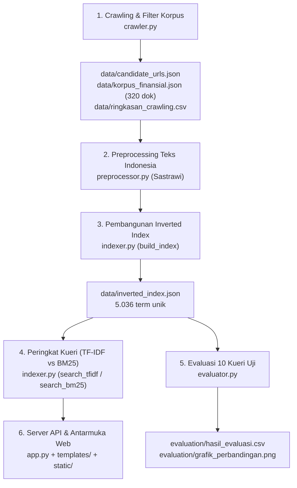

# FinEduSearch — Mesin Pencari Edukasi & Tips Finansial Pemula

**FinEduSearch** adalah aplikasi mesin pencari edukasi dan tips finansial pemula berbahasa Indonesia berbasis **Flask** (Proyek UAS Penelusuran Informasi) yang membandingkan algoritma **Vector Space Model (TF-IDF + Cosine Similarity)** dan **Okapi BM25** secara berdampingan (*side-by-side*).

Dokumen ini menjelaskan **alur pipeline pembuatan mesin pencari** dari tahap pengumpulan artikel hingga penyajian antarmuka web dan evaluasi.

---

## 1. Gambaran Besar Pipeline



---

## 2. Alur Pipeline Pembuatan Mesin Pencari

### Tahap 1 — Pengumpulan Korpus (*Web Crawling*) (`crawler.py`)
Pipeline dimulai dengan membangun korpus artikel finansial berbahasa Indonesia melalui dua sub-tahap di [`crawler.py`](crawler.py):

1. **Panen kandidat URL (`harvest_urls`)**
   - Memindai halaman indeks/tag terpaginasi dari `PAGINATED_SOURCES`:
     - CNBC MyMoney (`cnbcindonesia.com/mymoney/indeks/{page}`)
     - Kompas Perencanaan Keuangan (`kompas.com/tag/perencanaan-keuangan?page={page}`)
     - Kompas Literasi Keuangan (`kompas.com/tag/literasi-keuangan?page={page}`)
     - Detik Perencanaan Keuangan (`detik.com/tag/perencanaan-keuangan/?sortby=time&page={page}`)
     - Antara Finansial (`antaranews.com/ekonomi/finansial/{page}`)
   - Menggunakan `requests.Session` dengan mekanisme *retry* otomatis (`total=3`, status `429, 500, 502, 503, 504`) dan parser `BeautifulSoup` (`lxml`).
   - Menyaring URL sesuai pola regex `allow_pattern`, menormalkan URL unik, dan menyimpannya ke [`data/candidate_urls.json`](data/candidate_urls.json).

2. **Ekstraksi & validasi artikel (`extract_article_data` & `is_valid_financial_doc`)**
   - Menghapus elemen pengganggu (`script`, `style`, `nav`, `footer`, `header`, `aside`, `form`, `iframe`, `noscript`).
   - Mengambil tanggal publikasi dari tag `<meta>` (`article:published_time`, `publishdate`, atau `date`), judul dari `<h1>`, dan paragraf isi yang minimal `7` kata serta bebas awalan editorial (`NOISE_PREFIXES`, misal *"baca juga"*, *"advertisement"*).
   - Validasi dokumen mewajibkan judul unik, panjang isi minimal `100` kata, dan minimal `2` kecocokan kata kunci dari `FINANCE_KEYWORDS` (32 kata kunci seperti *uang, tabungan, investasi, reksadana, saham, dana darurat, gaji, utang, pajak, asuransi, pensiun*).
   - Menghentikan pengambilan saat mencapai `TARGET_DOCS = 320` dan menyimpan hasil ke [`data/korpus_finansial.json`](data/korpus_finansial.json) serta rekap metadata ke [`data/ringkasan_crawling.csv`](data/ringkasan_crawling.csv).

**Statistik korpus tersimpan saat ini:**
- **Total dokumen**: `320` artikel (`104` – `1.142` kata, rata-rata `394,2` kata/dokumen)
- **Distribusi sumber**: Antara Finansial (`162`), Detik Perencanaan Keuangan (`146`), Kompas Perencanaan Keuangan (`8`), Kompas Literasi Keuangan (`4`).

---

### Tahap 2 — Preprocessing Teks Bahasa Indonesia (`preprocessor.py`)
Setiap dokumen maupun kueri pencarian diproses seragam oleh kelas `IndonesianPreprocessor` pada [`preprocessor.py`](preprocessor.py) dengan urutan:

1. **Case Folding**: mengubah seluruh huruf menjadi huruf kecil (`text.lower()`).
2. **Cleaning**: menghapus tautan (`http\S+|www\S+`) dan karakter selain huruf `a-z` (`[^a-z\s]`).
3. **Tokenizing**: memecah teks menjadi daftar kata berdasarkan spasi (`text.split()`).
4. **Filter Panjang & Stopword Removal**: membuang kata berpanjang `<= 2` karakter dan kata umum menggunakan `StopWordRemoverFactory` dari **Sastrawi** ditambah 22 stopword editorial/domain (`"baca"`, `"juga"`, `"simak"`, `"berikut"`, `"tips"`, `"pemula"`, `"artikel"`, `"halaman"`, dll.).
5. **Stemming & Cache**: mengubah kata berimbuhan ke kata dasar menggunakan `StemmerFactory` dari **Sastrawi** dengan memoization (`stem_cache`), lalu memfilter ulang hasil stem terhadap panjang `> 2` dan daftar stopword.

---

### Tahap 3 — Pembangunan Inverted Index (`indexer.py`)
Kelas `FinancialSearchEngine` pada [`indexer.py`](indexer.py) (`build_index`) mengubah korpus bersih menjadi indeks pencarian siap kueri:

1. **Pembobotan zona judul**: menggabungkan judul sebanyak 2 kali di depan isi (`f"{doc['title']} {doc['title']} {doc['content']}"`) sebelum diproses `IndonesianPreprocessor` agar kemunculan term di judul berbobot lebih tinggi.
2. **Statistik term & dokumen**: mencatat frekuensi term per dokumen (`tf`), panjang token dokumen (`doc_lengths`), rata-rata panjang dokumen (`avg_doc_len`), dan frekuensi dokumen (`df`) untuk tiap term unik.
3. **Pra-perhitungan IDF & norma vektor**:
   - Menghitung $\text{idf}_t = \ln\left(\frac{N + 1}{\text{df}_t + 1}\right) + 1$.
   - Menghitung norma L2 tiap vektor dokumen (`doc_norms`) dari bobot log-TF $\left(1 + \ln(\text{tf}_{t,d})\right) \times \text{idf}_t$ agar pencarian Cosine Similarity berlangsung cepat saat runtime.
4. **Penyimpanan**: seluruh indeks disimpan ke [`data/inverted_index.json`](data/inverted_index.json) (`320` dokumen, `5.036` term unik, rata-rata `219,87` token/dokumen).

---

### Tahap 4 — Mesin Peringkat & Pencarian (`indexer.py`)
Saat menerima kueri pengguna, kueri melewati `IndonesianPreprocessor` yang sama, lalu dievaluasi oleh dua metode peringkat secara paralel:

1. **Vector Space Model (`search_tfidf`)**
   - Menghitung bobot kueri dan dokumen memakai *log-normalized TF-IDF*: $(1 + \ln(\text{tf})) \times \text{idf}$.
   - Mengurutkan dokumen berdasarkan **Cosine Similarity** ($\frac{\vec{q} \cdot \vec{d}}{\|\vec{q}\| \|\vec{d}\|}$).
2. **Okapi BM25 (`search_bm25`)**
   - Menggunakan parameter $k_1 = 1.5$ dan $b = 0.75$.
   - Menghitung $\text{idf}_t = \ln\left(\frac{N - \text{df}_t + 0.5}{\text{df}_t + 0.5} + 1\right)$ dan saturasi frekuensi term dengan normalisasi panjang dokumen (`doc_len / avg_doc_len`).

Kedua fungsi juga menghasilkan cuplikan teks (`_create_snippet`) dan mengukur waktu eksekusi (`time.perf_counter()` dalam milidetik).

---

### Tahap 5 — Evaluasi Offline (`evaluator.py`)
Skrip [`evaluator.py`](evaluator.py) menguji kualitas kedua algoritma terhadap `10` kueri uji (`TEST_QUERIES`) pada peringkat Top-5 (`k = 5`) dengan *ground truth* berbasis kecocokan `must_terms`:

- Metrik yang dihitung: `Precision@5`, `Recall@5`, `F1-Score@5`, `MAP@5`, `MRR`, dan latensi (ms).
- Output disimpan ke [`evaluation/hasil_evaluasi.csv`](evaluation/hasil_evaluasi.csv) dan grafik perbandingan ke [`evaluation/grafik_perbandingan.png`](evaluation/grafik_perbandingan.png).

| Metrik (Rata-rata 10 Kueri) | TF-IDF (VSM) | Okapi BM25 |
|---|---:|---:|
| **Precision@5** | `0.9800` | `0.9600` |
| **Recall@5** | `0.1768` | `0.1748` |
| **F1-Score@5** | `0.2889` | `0.2853` |
| **MAP@5** | `0.9710` | `0.9550` |
| **MRR** | `1.0000` | `1.0000` |
| **Rata-rata Latensi** | `0.1201 ms` | `0.0893 ms` |

---

### Tahap 6 — Server Flask & Antarmuka Web (`app.py`, `templates/`, `static/`)
Tahap terakhir menyajikan mesin pencari ke pengguna melalui web app tanpa build step (HTML + CSS + JavaScript vanilla):

1. **Backend Flask ([`app.py`](app.py))**:
   - Memuat `data/korpus_finansial.json` dan `data/inverted_index.json` saat startup melalui `engine.load_index()`.
   - `GET /`: merender [`templates/index.html`](templates/index.html) beserta statistik indeks (`total_docs`, `total_terms`, `avg_doc_len`).
   - `GET /api/search?q=<kueri>&top_k=10`: menjalankan `search_tfidf` dan `search_bm25`, menghitung `overlap_count`, dan mengembalikan JSON berisi token preprocessing, skor, cuplikan, isi artikel, serta latensi masing-masing algoritma.

2. **Antarmuka Web ([`templates/index.html`](templates/index.html), [`static/tokens.css`](static/tokens.css), [`static/style.css`](static/style.css), [`static/script.js`](static/script.js))**:
   - Mengikuti spesifikasi [`design.md`](design.md) dengan tema terang/gelap (`localStorage` + `prefers-color-scheme`).
   - **State `idle`**: menampilkan kolom pencarian, kueri contoh, bento statistik korpus, dan diagram alur 3 langkah.
   - **State `results`**: menyembunyikan bento & elemen beranda agar fokus ke perbandingan; menampilkan token hasil Sastrawi, bar irisan, dua kolom sejajar per peringkat dengan header *sticky*, hover berpasangan (`data-doc-id`), highlight kemunculan pertama token, badge perbedaan/posisi di algoritma lawan, serta modal baca artikel lengkap.
   - **Responsif**: grid dua kolom pada `>= 640 px` dan tab interaktif pada `< 640 px`.

---

## 3. Menjalankan Pipeline

1. **Instalasi dependensi**
   ```bash
   pip install -r requirements.txt
   ```
2. **Menjalankan seluruh pipeline dari nol (opsional — data & indeks sudah tersedia di `data/`)**
   ```bash
   python crawler.py      # Tahap 1: crawling & validasi 320 artikel
   python indexer.py      # Tahap 2-3: preprocessing & bangun inverted_index.json
   python evaluator.py    # Tahap 5: evaluasi 10 kueri & buat grafik PNG/CSV
   ```
3. **Menjalankan aplikasi web mesin pencari**
   ```bash
   python app.py
   ```
   Buka `http://127.0.0.1:5000` di browser.

---

## 4. Struktur Proyek

```text
testingmesinpencari/
├── README.md                     # Dokumentasi alur pipeline mesin pencari
├── design.md                     # Spesifikasi sistem desain UI ("Calm Data")
├── requirements.txt              # Daftar dependensi Python
├── crawler.py                    # Tahap 1: Web scraper & filter korpus finansial
├── preprocessor.py               # Tahap 2: Preprocessing teks Indonesia (Sastrawi)
├── indexer.py                    # Tahap 3-4: Inverted Index, TF-IDF, dan Okapi BM25
├── evaluator.py                  # Tahap 5: Evaluasi metrik & pembuat grafik
├── app.py                        # Tahap 6: Server Flask & API /api/search
├── data/
│   ├── candidate_urls.json       # Cache daftar URL kandidat hasil panen
│   ├── korpus_finansial.json     # Dataset 320 artikel finansial bersih
│   ├── inverted_index.json       # Inverted index, IDF, dan norma dokumen
│   └── ringkasan_crawling.csv    # Rekap metadata hasil crawling
├── evaluation/
│   ├── hasil_evaluasi.csv        # Skor metrik evaluasi per kueri uji
│   └── grafik_perbandingan.png   # Grafik perbandingan akurasi & latensi
├── static/
│   ├── tokens.css                # Design tokens tema terang & gelap
│   ├── style.css                 # Layout, state UI, komponen, & responsif
│   └── script.js                 # Fetch API, state, highlight, modal, & tema
└── templates/
    └── index.html                # Halaman antarmuka FinEduSearch
```
